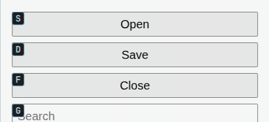

# Thodu

Thodu is a keyboard hint picker for Omarchy. It labels clickable controls in every visible window on the focused monitor and in the Omarchy bar, so you can choose them without reaching for the pointer. Thodu means "touch" in Tamil.

This is an early, Omarchy-only milestone. It uses accessibility trees for GTK 3, GTK 4, Qt Widgets, Chromium controls and Electron controls, plus clickable items in the Omarchy bar. Default hints cover mapped windows on the focused monitor's active workspace, shown special workspace and pinned clients. One label sequence spans those windows, with the shortest labels placed near the top-left. `--scope focused` and `--window` restrict collection to one window.

Every visible-window collection also runs a bounded monitor screenshot detector after primary targets draw. It can add click hints for visible text lines and box-like controls that apps do not expose in their accessibility trees, even when other controls are accessible. These image hints have no searchable text and use an amber style. They can miss controls, and may label visible text that is not interactive. A grid remains available for choosing any point on the focused monitor. Scroll mode finds AT-SPI scroll panes and web document viewports across visible windows, with a window-sized fallback for apps that expose no scroll area. Dragging and hovering are not supported.

When no app window is focused, Thodu uses the focused monitor and still labels the Omarchy bar. If no source finds targets, it opens the grid.

In an interactive session, primary hints appear first and visual hints arrive in a second update. Labels already on screen stay attached to their targets. Thodu ignores label keys while visual hints load; `Escape` remains available.

## Install

Requirements:

- Omarchy with Hyprland using the Lua configuration.
- `grim`, for screenshot-based visual supplementation of visible windows.
- The Rust toolchain pinned in `rust-toolchain.toml` to build from source.
- `python3`, to read Cargo's configured target directory in the install commands below.
- An active graphical session. Installation configures accessibility, the virtual input device rule, the Omarchy plugin, a user service and Hyprland bindings.

Build and install the executables side by side. The `thodu install` command uses the `thodud` executable beside it:

```sh
set -eu
cargo build --release
target_dir="$(cargo metadata --no-deps --format-version 1 | python3 -c 'import json,sys; print(json.load(sys.stdin)["target_directory"])')"
: "${target_dir:?ERROR could not determine Cargo target directory}"
install -Dm755 "$target_dir/release/thodu" "$HOME/.local/bin/thodu"
install -Dm755 "$target_dir/release/thodud" "$HOME/.local/bin/thodud"
thodu install
thodu doctor
```

The first install with no existing Thodu bindings uses `SUPER + SHIFT + F12` for hints, `SUPER + CTRL + F12` for the grid and `SUPER + ALT + F12` for scroll mode. Re-running the installer preserves existing hints and grid keys, and adds the default scroll key if missing. To change only the scroll key, pass `--scroll-key`; this preserves your other Thodu keys. To set or replace both hints and grid bindings explicitly, pass both options:

```sh
thodu install \
  --hints-key "SUPER + CTRL + SPACE" \
  --grid-key "SUPER + CTRL + SHIFT + SPACE"
```

For example, to use `CTRL + ALT + SPACE` for scroll mode while keeping your existing hints and grid bindings:

```sh
thodu install --scroll-key "CTRL + ALT + SPACE"
```

Installation may ask for authorization to add the `/dev/uinput` rule. `thodu doctor` reports which installation requirements are present. If the Omarchy shell was not restarted by the installer, run `omarchy restart shell` and then `thodu doctor` again.

## Chromium, Electron and web apps

`thodu install` configures `ACCESSIBILITY_ENABLED=1` in the Omarchy Hyprland session. `thodu doctor` checks that session configuration; it cannot change the environment of apps that were already running.

### Chromium and Chromium-based web apps

Close every Chromium window, including standalone app windows, then wait for all Chromium processes to exit before relaunching. Chromium app windows can reuse an existing browser process, so reopening only a web app while the old process is still running may keep the old environment. Start the browser and its installed web apps again from Omarchy after `thodu install`.

Chromium-based web apps, including Slack opened in its own window, use this same Chromium setup. If a window has no AT-SPI targets, open `chrome://accessibility` to inspect or enable the tree for the current run. Chromium documents `--force-renderer-accessibility` as a fallback. On Arch, put that flag on its own line in `~/.config/chromium-flags.conf`, then fully quit and restart all Chromium windows and processes. Prefer the normal Thodu session setup first because forced accessibility can keep more of the browser tree active. Scroll mode sends discrete wheel input through Hyprland's virtual-pointer protocol, so it does not require a browser extension. See [Chromium's accessibility documentation](https://www.chromium.org/developers/design-documents/accessibility/) and the ArchWiki section on [persistent Chromium flags](https://wiki.archlinux.org/title/Chromium#Making_flags_persistent).

### Electron apps

Electron normally enables accessibility when it detects assistive technology. Quit and relaunch Electron apps from Omarchy after installing Thodu. If an app was started outside the Omarchy session, close it and start it with the environment prefix, for example `ACCESSIBILITY_ENABLED=1 obsidian`. Scroll mode sends wheel input through Hyprland's virtual-pointer protocol for Electron too. For a Flatpak app, set the variable for that app and restart it:

```sh
flatpak override --user --env=ACCESSIBILITY_ENABLED=1 APP_ID
```

Replace `APP_ID` with the app's Flatpak ID. To remove the override later, run `flatpak override --user --unset-env=ACCESSIBILITY_ENABLED APP_ID`. Flatpak overrides are per-app and persist for the user. If controls remain missing, check the app's accessibility settings and bundled Electron version. See [Electron's accessibility documentation](https://www.electronjs.org/docs/latest/tutorial/accessibility/) and the [Flatpak override reference](https://docs.flatpak.org/en/latest/flatpak-command-reference.html#flatpak-override).

### Web page coverage

Thodu reads controls that Chromium and Electron expose through AT-SPI. Individual sites can omit controls or use custom widgets that expose no useful accessibility information. The planned Chromium extension is not included, so general website coverage remains limited. Screenshot hints may add visible candidates, but they do not understand a page's control semantics and can miss targets. Scroll mode remains usable on a window-sized fallback when a browser does not expose semantic panes; this lets wheel scrolling work but cannot identify individual nested page panes.

The screenshot below shows Thodu labeling the Open, Save and Close buttons exposed by the local Chromium reference page:



## Use

- Press the hints binding to show labels across every visible window on the focused monitor and the bar. Primary targets appear first; visual candidates arrive in a second pass.
- Add `--scope focused` to `thodu hints` or `thodu targets` to restrict a request to the focused window. `--window ADDRESS` selects one specific window.
- In the default search-first mode, type text to narrow targets. Use `Shift` with a label letter to enter a label. In labels-only mode, type a label directly; press `/` to search by text.
- Completing a label in lowercase focuses it. Making the label's final letter uppercase activates it immediately. `Return` activates the focused target.
- `Tab` and `Shift+Tab` move focus. `Escape` closes the session. `Space` opens the grid when no target is focused.
- `Shift+Return` right-clicks, `Control+Return` clicks with Control held, and two distinct `Return` presses within 300 ms double-click.
- Press the grid binding to choose a point on the focused monitor. Select a cell to refine it, then press `Return` to click its center.
- Press the scroll binding (`SUPER + ALT + F12` by default) to select and scroll panes across visible app windows on the focused monitor. Hold `j`/`k` to scroll down/up continuously and `h`/`l` to scroll left/right. A tap sends one wheel action; holding repeats every 80 ms. `Shift` uses `scroll_shift_step`. The overlay keeps keyboard capture while passing wheel input through to the selected pane. `Tab` and `Shift+Tab` cycle areas, digits select an area by its number, `Return` clears the number prefix, and `Escape` exits.

The configuration file is `~/.config/thodu/config.toml` and is read at the start of each session. Supported settings are:

```toml
labels_only = true
status_display = "auto"
scroll_step = 1
scroll_shift_step = 5
```

`labels_only` defaults to `false`, which starts in search-first mode. `status_display` accepts `auto`, `always` or `off` and defaults to `auto`. Auto hides routine source counts two seconds after the overlay appears; warnings, missing targets, active collection, search text and the key cue remain visible. `scroll_step` and `scroll_shift_step` default to 1 and 5 wheel detents, and each accepts 1 through 100. The Shift step can be smaller than the normal step. Restart an active session after changing settings.

## Commands

```sh
thodu hints                  # show target labels across visible windows
thodu hints --scope focused  # show targets from the focused window only
thodu grid                   # choose a point with the grid
thodu scroll                 # select and scroll a pane in any visible app window
thodu scroll --scope focused # scroll only the focused app window
thodu targets --json         # print targets from visible windows
thodu targets --scope focused --json  # print targets from the focused window
thodu doctor                 # check the installation
thodu bench --sessions 50    # measure time until labels are drawn
thodu record-tree --out tree.json  # record the focused app accessibility tree
```

Each JSON target includes its `window` address and supported `actions`.

`thodu hints` and `thodu grid` accept `--window ADDRESS` to target a Hyprland window address or `class:NAME`. The `--test` option shows an overlay without taking the keyboard, and `--no-overlay` runs a session without showing it. Benchmark samples are stored under `~/.local/share/thodu/bench/`.

## Development

```sh
cargo test
tools/gate
```

`tools/gate` runs the full project gate, including Rust, QML and acceptance checks. `make install` copies only the Omarchy plugin files; `make reload` copies them and restarts the Omarchy shell. Use `thodu install` to configure the service, plugin, accessibility environment, input rule and keybindings for the installed executables.

The project contract is in [SEED.md](SEED.md) and [SPEC.md](SPEC.md). Work items and their acceptance checks are in [tasks/](tasks/). The repository workflow is documented in [AGENTS.md](AGENTS.md).

The screenshot fallback uses the [Woints](https://github.com/wochap/woints) classical detector, pinned to a source revision in `Cargo.toml`. Woints is MIT licensed.
