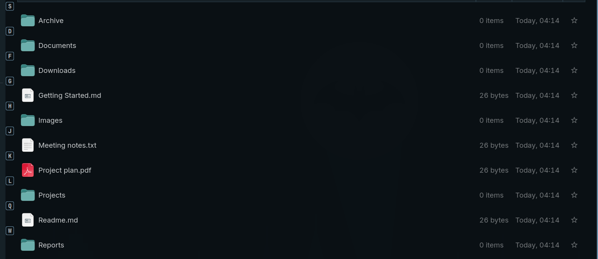
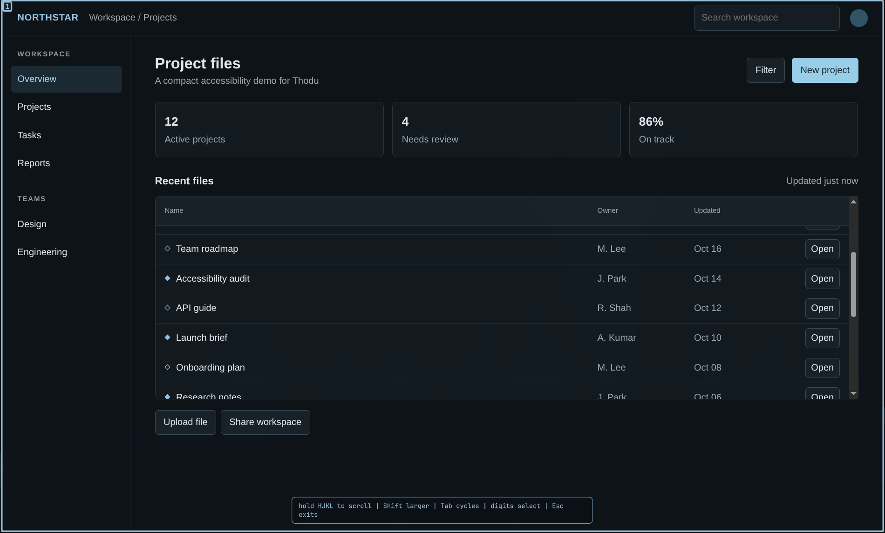
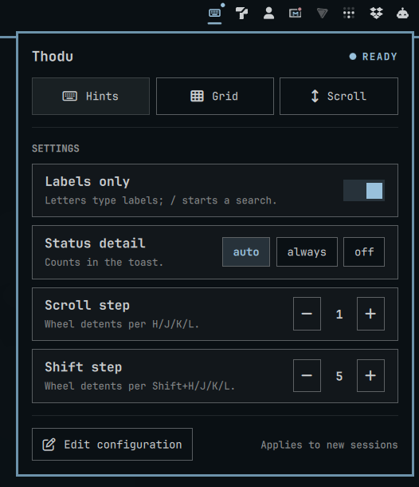

# Thodu

Keyboard hints for everything visible on an Omarchy screen. Thodu finds controls across visible app windows and the top bar, then lets you select and activate them without reaching for the pointer.





## Features

- Click hints for GTK, Qt, Chromium, Electron and Omarchy bar controls.
- Screenshot hints for visible controls missing from an app's accessibility tree.
- Grid mode to click any point, and HJKL scroll mode across visible windows.
- Labels-only, text search, uppercase final-key activation and configurable scroll speed.
- A top-bar control for service status, mode launchers and live settings.



Accessibility support varies by app. Visual hints can include non-interactive text or miss controls. See [app setup](docs/accessibility.md) for Chromium, Electron and web app guidance.

## Install

Requires Omarchy with Hyprland. Follow the [installation instructions](docs/install.md) to build both binaries and configure the plugin, service and keybindings. Run `thodu doctor` to check the setup.

## Keys

| Mode | Default shortcut | In-session keys |
| --- | --- | --- |
| Hints | `Super+Shift+F12` | Search text; `Shift`+label selects. Uppercase the final label key to activate. `Return` activates the focused target. |
| Grid | `Super+Ctrl+F12` | Type a label to refine the grid, then `Return` to click. |
| Scroll | `Super+Alt+F12` | Hold `j`/`k` to scroll down/up, `h`/`l` left/right. `Tab` cycles areas, digits select, `Escape` exits. |

See [usage and configuration](docs/usage.md) to change shortcuts, scroll steps or hint behavior.

## Development

```sh
cargo test
tools/gate
```

The project contract is in [SEED.md](SEED.md) and [SPEC.md](SPEC.md). The screenshot fallback uses [Woints](https://github.com/wochap/woints), pinned in `Cargo.toml` under its MIT license.

## License

MIT; see [LICENSE](LICENSE).
